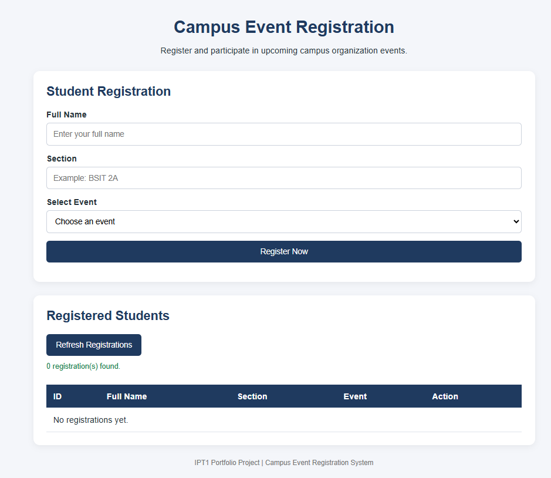
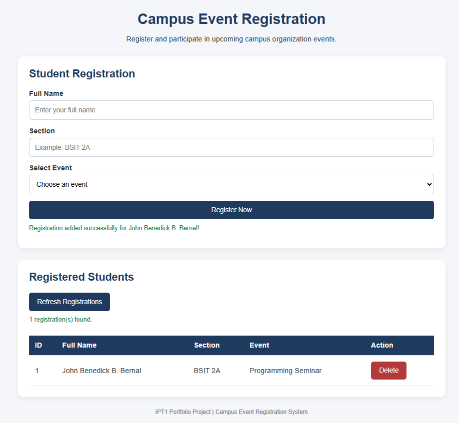
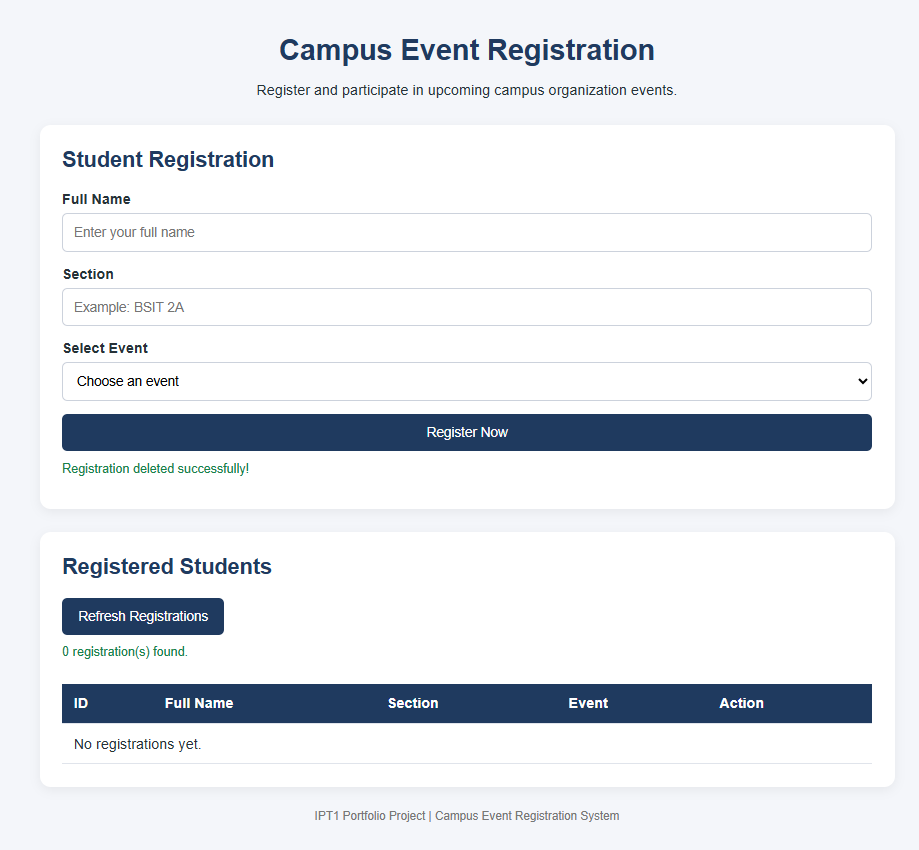
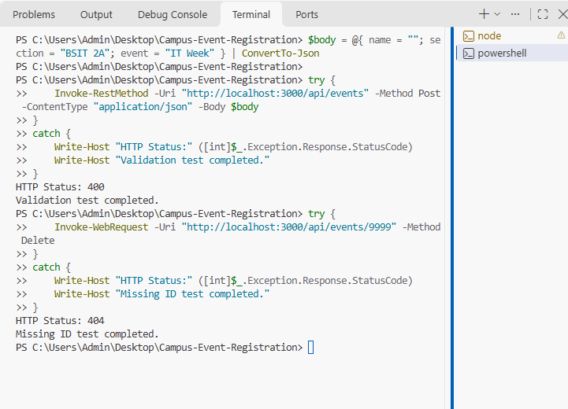

# Campus Event Registration System

A full-stack web application developed for the IPT1 Track 2 Portfolio Output. It allows students to register for campus organization events and allows organizers to view and remove registrations.

## Features

- Add student event registrations.
- View all registered students.
- Delete existing registrations.
- Validate required fields on the server.
- Display loading, success, and error messages.
- Handle invalid requests and nonexistent registration IDs.
- Communicate with the backend using REST API and JSON.

## Technologies Used

- HTML
- CSS
- JavaScript
- Node.js
- Express.js
- REST API
- JSON

## Project Structure

```text
Campus-Event-Registration/
│
├── public/
│   ├── index.html
│   └── app.js
│
├── server.js
├── package.json
├── package-lock.json
├── README.md
└── .gitignore
```

## Installation and Running

1. Install Node.js LTS.
2. Open the project folder in VS Code.
3. Open the terminal.
4. Install the dependencies:

   ```bash
   npm install
   ```

5. Start the server:

   ```bash
   npm start
   ```

6. Open the application in your browser:

   http://localhost:3000

## API Documentation

The application uses the following REST API endpoints:

| Method | Endpoint | Description | Success Status |
|---|---|---|---|
| GET | `/api/events` | Get all registrations | 200 |
| POST | `/api/events` | Add a new registration | 201 |
| DELETE | `/api/events/:id` | Delete a registration by ID | 204 |

### POST Request Example

Endpoint:

`POST /api/events`

Request body:

```json
{
  "name": "John Benedick Bernal",
  "section": "BSIT 2A",
  "event": "IT Week"
}
```

Successful response: `201 Created`

```json
{
  "id": 1,
  "name": "John Benedick Bernal",
  "section": "BSIT 2A",
  "event": "IT Week"
}
```

### Error Handling

| Status Code | Description |
|---|---|
| 400 | Missing or invalid registration information |
| 404 | Registration ID or API endpoint not found |

## Application Screenshots

Screenshots of the working application will be added below.

### 1. Registration Form and Student List



### 2. Successful Registration



### 3. Registration Deletion



### 4. Validation and Error Handling



## Integration Trace

### Process: Adding a Student Registration

1. The student enters their full name, section, and selected event in the registration form.
2. The frontend JavaScript handles the form submission using the `form.addEventListener("submit", ...)` function in `public/app.js`.
3. The frontend sends a POST request to `/api/events` using `fetch()`.
4. The request includes the student's information in JSON format.
5. The backend receives the request through the POST `/api/events` route in `server.js`.
6. The server validates the name, section, and event fields.
7. If the information is valid, the server creates a registration with a unique ID and stores it in the registration list.
8. The server responds with HTTP status `201 Created` and the new registration object.
9. The frontend displays a success message, clears the form, and reloads the registration list using `loadRegistrations()`.

### Adapting the System for a Mobile Application

If the system is adapted into a mobile application, the frontend should be changed first. The mobile application would need a different user interface designed for smaller screens and touch controls. However, the existing backend API can still be used because it accepts JSON requests and responds with JSON data. This means the mobile application can communicate with the same backend without rewriting the main registration logic.


## Group Members and Contributions

| Group Member | Contribution |
|---|---|
| John Benedick B. Bernal | Worked on the backend and frontend implementation, including the Express API, registration form, and JavaScript functions. Also performed API testing and prepared the project documentation. |
| Jessie M. Barnido | Collaborated on the project development by reviewing the system, checking its functionality, and assisting with testing and documentation. |


## Data Storage

The application currently uses in-memory storage. This means registration records reset when the server restarts. Connecting the system to a database such as MySQL or MongoDB can be added as a future improvement.